<div align="center">

[Русский](README.md) · **English**

<br>



<a href="https://github.com/sailxx/Flipt/releases/latest/download/Flipt.exe"></a>

</div>

<br>

You want to see the time big and stay focused — but the system clock is tiny and clock websites are full of ads. **Flipt** is a large flip clock on a pure black screen plus a 25-minute focus timer. No installer, no network, no clutter.

<br>



<br>



<br>



## Install

1. Download [`Flipt.exe`](https://github.com/sailxx/Flipt/releases/latest/download/Flipt.exe) and put it in a permanent folder, e.g. `%LOCALAPPDATA%\Flipt`.
2. Run it. Pin it to Start or the taskbar if you like.

Requires Windows 10 or 11: .NET Framework 4.8 is built in.

> Windows SmartScreen may warn about an unknown publisher because the file is not signed with a paid certificate. Click "More info → Run anyway", or build it yourself.

<details>
<summary><b>How to verify the exe was built from this code</b></summary>

Every release is built by GitHub Actions from source, and GitHub signs the build provenance:

```bash
gh attestation verify Flipt.exe --repo sailxx/Flipt
```

The SHA-256 checksum ships next to the exe in every release (`Flipt.exe.sha256`):

```powershell
Get-FileHash .\Flipt.exe -Algorithm SHA256
```

</details>

## Build from source

```bash
git clone https://github.com/sailxx/Flipt.git
```

```bash
Flipt\build.cmd
```

The C# compiler ships with Windows — nothing to install.

| File | What's inside |
|---|---|
| `Flipt.cs` | Window, flip tiles, timer, buttons |
| `flipt.ico` | Icon: a 3×3 dot grid forming an F |
| `app.manifest` | Runs without admin rights |
| `tools/readme/` | README image generator (`npm install && node build.mjs`) |

## License

[MIT](LICENSE) © sailxx
