<div align="center">

**Русский** · [English](README.en.md)

<br>



<a href="https://github.com/sailxx/Flipt/releases/latest/download/Flipt.exe"></a>

</div>

<br>

Хочется видеть время крупно и не отвлекаться — но системные часы крошечные, а сайты с часами шумят рекламой. **Flipt** — большие flip-часы на чистом чёрном экране и таймер фокуса на 25 минут. Без установки, без сети, без лишних кнопок.

<br>



<br>



<br>



## Установка

1. Скачайте [`Flipt.exe`](https://github.com/sailxx/Flipt/releases/latest/download/Flipt.exe) и положите в постоянную папку, например `%LOCALAPPDATA%\Flipt`.
2. Запустите. Ярлык можно закрепить в «Пуске» или на панели задач.

Нужна Windows 10 или 11: .NET Framework 4.8 уже встроен в систему.

> Windows SmartScreen может предупредить о неизвестном издателе: файл не подписан платным сертификатом. Нажмите «Подробнее → Выполнить в любом случае» или соберите программу сами.

<details>
<summary><b>Как проверить, что exe собран из этого кода</b></summary>

Каждый релиз собирает GitHub Actions прямо из исходников, а GitHub подписывает происхождение файла (build provenance):

```bash
gh attestation verify Flipt.exe --repo sailxx/Flipt
```

Контрольная сумма SHA-256 лежит рядом с exe в каждом релизе (`Flipt.exe.sha256`):

```powershell
Get-FileHash .\Flipt.exe -Algorithm SHA256
```

</details>

## Сборка из исходников

```bash
git clone https://github.com/sailxx/Flipt.git
```

```bash
Flipt\build.cmd
```

Компилятор C# уже есть в Windows — ничего устанавливать не нужно.

| Файл | Что внутри |
|---|---|
| `Flipt.cs` | Окно, плитки с анимацией, таймер, кнопки |
| `flipt.ico` | Значок: сетка точек 3×3 с буквой F |
| `app.manifest` | Запуск без прав администратора |
| `tools/readme/` | Генератор картинок README (`npm install && node build.mjs`) |

## Code signing policy

Free code signing provided by [SignPath.io](https://signpath.io), certificate by [SignPath Foundation](https://signpath.org).

- **What is signed:** only the official `Flipt.exe` that GitHub Actions builds from this repository when a `v*` tag is pushed (see `.github/workflows/release.yml`). Builds from forks, branches or local machines are never signed.
- **Team roles:** committer, reviewer and approver of every signing request — [@sailxx](https://github.com/sailxx). Two-factor authentication is required for the GitHub and SignPath accounts.
- **Privacy:** this program will not transfer any information to other networked systems unless specifically requested by the user or the person installing or operating it.
- **Verification:** besides the signature, every release carries a SHA-256 file and a GitHub build provenance attestation (`gh attestation verify Flipt.exe --repo sailxx/Flipt`).

## Лицензия

[MIT](LICENSE) © sailxx
